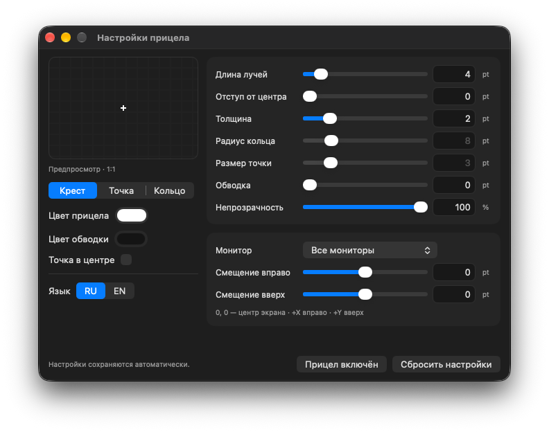

# Crosy

A small macOS app that puts a crosshair in the center of your screen. Pick a shape, adjust it to your liking, and get back to your game. The overlay stays above your apps and lets mouse clicks pass through.

> **holy-vibecoded** (made with AI)

<p align="center">
  
</p>

### Features

- **Three shapes** — cross, dot, or circle, with an optional center dot.
- **Live adjustments** — change colors, size, outline, opacity, and position while you watch the preview.
- **Multiple displays** — show the crosshair on your main display, a specific one, or all of them.
- **Menu bar controls** — show or hide the crosshair, open settings, or quit.
- **Russian & English** — switch between **RU / EN** right in the settings window. No restart needed.
- **Saved preferences** — your crosshair settings and language are remembered between launches.

### Build & Run

To run Crosy, you'll need **macOS 13+**. To build it, use **Xcode 26+** or matching Command Line Tools with a **macOS 26+ SDK** and **Swift 6+**. There are no third-party dependencies.

If you don't have Command Line Tools yet:

```sh
xcode-select --install
```

Then, from the project folder:

```sh
./build.sh
open .build/release/Crosy.app
```

The build compiles **arm64 and x86_64** separately for **macOS 13.0+**, merges them with `lipo`, signs `Crosy.app`, and creates `dist/Crosy-macOS-universal.zip`. The ZIP contains `Crosy.app` and preserves executable permissions, resources, and the signature. The build extracts and verifies the ZIP automatically. Swift 6 is needed to build, not to run the app.

You can copy the built app to **Applications** and launch it from there next time.

### Download & first launch

Download `Crosy-macOS-universal.zip` from this repository's GitHub Releases, extract it, and move **Crosy.app** to **Applications**. Local builds and the default CI artifact use a free **ad-hoc signature**. This verifies bundle integrity; it does **not** identify the developer or bypass Gatekeeper.

If macOS blocks the first launch, and you trust the download source:

1. Try opening Crosy in Finder and dismiss the warning.
2. Open **System Settings → Privacy & Security**, find the blocked Crosy app, and select **Open Anyway**.
3. Confirm with your password or Touch ID if requested, then select **Open**.

Do not override a warning that the app contains malware. See [Apple's safe opening instructions](https://support.apple.com/en-us/102445). Crosy does not disable Gatekeeper or SIP and does not remove quarantine attributes.

A first launch without the unidentified-developer/notarization block requires **Developer ID Application signing and Apple notarization**. This requires Apple Developer Program membership; it is optional for building Crosy.

### Existing preferences

On the first launch without CLI arguments, Crosy copies crosshair settings and language from the previous `local.luxora.CrosshairOverlay` preferences domain (or the old standalone `CrosshairOverlay` domain). Existing Crosy values take priority. The old preferences are retained; resetting Crosy later does not import them again. Keys and the saved settings format are unchanged.

### Using the App

Open the app, choose a shape, and adjust the sliders or type exact values into the fields. Changes take effect immediately and save automatically. Settings that don't apply to the current shape are dimmed.

Use **RU / EN** at the bottom of the left column to change the interface language. This translates the settings, tooltips, menu bar controls, and reset dialog. Resetting your crosshair settings keeps your language choice.

Closing the settings window leaves the crosshair running. Click the crosshair icon in the menu bar to bring settings back, hide the overlay, or quit the app. **⌘⇧H** also toggles the crosshair while the app is active.

Sizes are measured in macOS points. Position `0, 0` is the center of the screen; positive offsets move the crosshair right and up.

### Command Line

Prefer the terminal? Launch with arguments to use the overlay without opening settings:

```sh
.build/release/Crosy --color 00FF00 --length 12 --gap 5 --center-dot
```

CLI options don't overwrite your saved app settings. Press **Ctrl+C** to stop the process.

See [CLI documentation](docs/CLI.md) for more examples, or run:

```sh
.build/release/Crosy --help
```

### Technology Stack

- **Swift 6**
- **AppKit** + **Core Graphics**
- **Swift Package Manager**

<details>
<summary>Project structure & build details</summary>

```text
Sources/CrosshairOverlay/
  App.swift              Entry point and launch mode
  Options.swift          Configuration and CLI parsing
  Overlay.swift          Crosshair rendering and lifecycle
  Settings.swift         Native settings interface
  Localization.swift     Russian and English UI strings
  PreferencesMigration.swift  One-time legacy preference migration
Resources/Info.plist     App bundle metadata
Resources/AppIcon.svg   Vector icon source
Resources/AppIcon.icns  macOS app icon
scripts/build.sh         Universal binary, .app, signing and ZIP
scripts/verify.sh        Extracted archive verification
build.sh                 Build entry point
Package.swift            Swift package manifest
docs/CLI.md              Terminal usage
.github/workflows/       macOS build checks
```

`./build.sh` produces a Universal standalone binary and signed `.app` in `.build/release/`, plus the distribution ZIP in `dist/`. Build outputs are ignored by Git. GitHub Actions runs tests, builds both architectures, verifies the extracted ZIP, and uploads it as a workflow artifact. It does not publish a GitHub Release.

`Resources/AppIcon.svg` is the vector icon source; `Resources/AppIcon.icns` includes 16, 32, 128, 256, and 512 point sizes at 1× and 2× (up to 1024 pixels). Regenerate it after editing the SVG with `./scripts/build-icon.sh`, using only macOS frameworks, `sips`, and `iconutil`.

Run regression tests with `swift test`; recheck a packaged archive with `./scripts/verify.sh`. Universal packaging checks do not replace testing on physical Intel Macs and older supported macOS releases.

Optional Developer ID signing (certificate and private key already installed in your keychain):

```sh
CODESIGN_IDENTITY='Developer ID Application: Your Name (TEAMID)' ./build.sh
```

For signing, notarization, and stapling in one build, first store credentials using `xcrun notarytool store-credentials`, then use the profile name:

```sh
CODESIGN_IDENTITY='Developer ID Application: Your Name (TEAMID)' \
NOTARY_PROFILE='crosy-notary' ./build.sh
```

This enables hardened runtime and secure timestamping, submits the ZIP with `notarytool --wait`, staples the ticket to the app, and repacks and verifies the final ZIP. Credentials are not stored in the repository. Notarization requires network access and Xcode's `notarytool`/`stapler`. See [Apple's notarization documentation](https://developer.apple.com/documentation/security/notarizing-macos-software-before-distribution).

Build with a macOS 26+ SDK to retain the current native AppKit appearance on modern macOS. The deployment target remains macOS 13; Intel support does not change the interface. The build and archive checks reject older SDKs.

To use a different compatible SDK:

```sh
SDKROOT=/path/to/MacOSX.sdk ./build.sh
```

To build only the standalone binary with Swift Package Manager:

```sh
swift build -c release
```

</details>

### Notes

See [validation results and remaining checks](docs/VALIDATION.md) for the tested environment and local toolchain limitations.

No Accessibility or Screen Recording permissions are needed. Some games with exclusive fullscreen rendering may hide the overlay; try a borderless window if that happens.

### License

[MIT](LICENSE)

---

© 2026 luxora.
